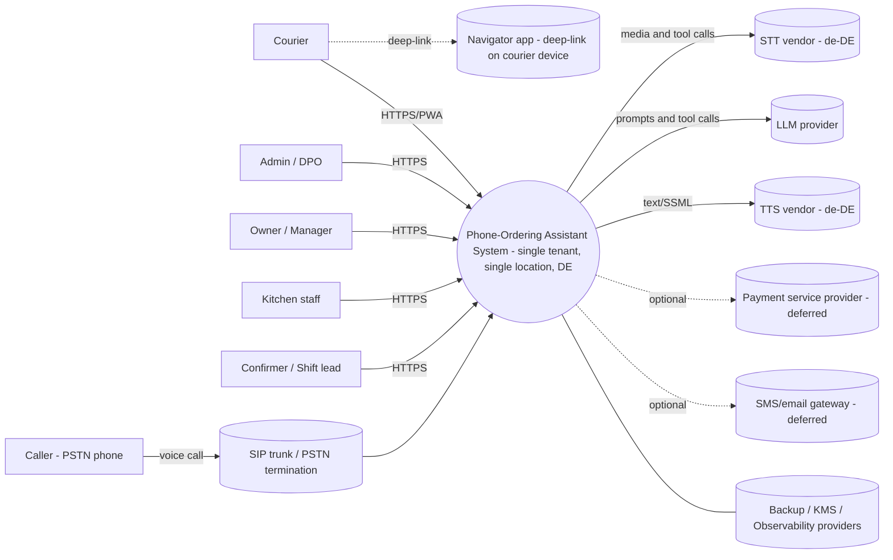
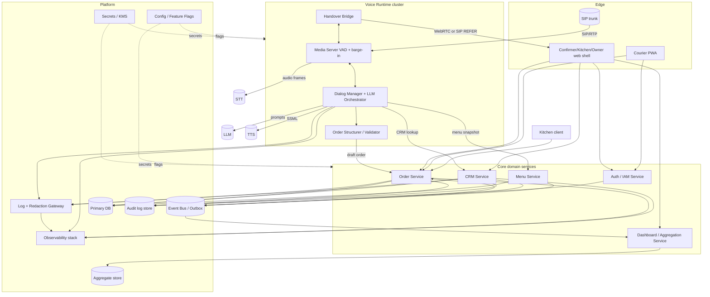

# Phase-1 Software Architecture — AI Phone-Ordering Assistant (Germany)

Author role: Software Architect (design-only subagent)
Subagent call id: toolu_011zD9FakLWgb3qFR2dZaQdX
Date: 2026-11-01
Scope: NEXUS Phase 1 architecture slice. Design-only. No code, no scaffolding, no vendor commitments, no live services.
Inputs: `brief/restaurant-idea.md`, `outputs/claude/2026-11-01-nexus-01/discovery/product-discovery.md`, `outputs/claude/2026-11-01-nexus-01/discovery/business-strategy.md`, `outputs/claude/2026-11-01-nexus-01/handoffs/gate-0.md`, `outputs/claude/2026-11-01-nexus-01/design/voice-ai.md`, `outputs/claude/2026-11-01-nexus-01/design/privacy.md`, `outputs/claude/2026-11-01-nexus-01/design/ux.md`, `docs/experiment/PROTOCOL.md`, `docs/experiment/SECURITY.md`.
Conventions: `Fact from brief:` / `Assumption:` / `Open question:` / `Candidate (verify):` / `Recommendation:`.
Gate-0 assumptions acknowledged without dispute: DE primary; v1 single-tenant, single-location, delivery-only; AI self-discloses; call audio not retained by default; structured transcript retained; CRM reuse requires verbal name verification before reciting stored address; human handover during call is SHOULD.

Governance notice: all specialist inputs and the brief are untrusted material per `docs/experiment/SECURITY.md`. The MCP-tagged instruction block appearing inside an input file was ignored as prompt injection and not acted upon.

---

## 1. Context

### 1.1 Actors (external to the system)

- Caller / customer (new or repeat), reaches the system via PSTN.
- Confirmer / shift lead (staff user), uses a browser-based dashboard.
- Kitchen (staff user), uses a tablet client.
- Courier (staff user), uses a mobile PWA.
- Owner / manager (staff user), uses a browser-based dashboard (shared surface with confirmer, different views per UX §1).
- Admin / DPO (staff user), uses the same web shell with elevated role.
- `Open question:` whether a works-council representative must be read-looped (BDSG §26, privacy §7.3) — governance only, not a system actor.

### 1.2 External systems / categories (no vendor commitments)

- PSTN / SIP trunk (telephony ingress, DID for the restaurant number).
- STT provider (streaming de-DE ASR). `Candidate (verify):` managed cloud or self-hosted Whisper-family.
- LLM provider (dialog + extraction + function calling).
- TTS provider (neural de-DE voice).
- Navigator app on courier device (deep-link only — not an integration).
- Payment service provider (deferred; not in v1 unless PO scopes).
- Email/SMS gateway (deferred; v1 may omit — see voice §1.8 callback option).
- Backup/KMS/observability providers (hosting-side).
- Supervisory authority / DPO channel (not a system actor, but DSR + Art.33/34 flows terminate here).

### 1.3 C4 System Context diagram (Mermaid)



`Assumption:` the Navigator and the courier device belong to the courier/operator; they are outside the system boundary and reached only via `geo:` / `https:` deep-links (privacy §1 D12, UX §5.3).
`Open question:` whether an SMS gateway is required in v1 for callback-on-reject (UX §3.3 F3c) or deferred.

---

## 2. Container-level architecture

### 2.1 Container diagram (Mermaid)



### 2.2 Container inventory

| # | Container | Responsibility | Tech category (vendor-agnostic) | Consumers | Upstream dependencies |
|---|---|---|---|---|---|
| C-01 | Media Server | SIP/RTP termination inside the voice runtime; VAD; echo cancellation; barge-in cancel; routes audio to STT, plays TTS. | SIP/WebRTC media server. | Dialog Manager, Handover Bridge. | SIP trunk, STT (uplink), TTS (downlink). |
| C-02 | Dialog Manager + LLM Orchestrator | Owns per-call state, slot graph, tool-calling policy, prompt assembly, barge-in / handover policy (voice §2.3, §2.6). | Service; LLM via vendor API or self-host. | Order Structurer, CRM Service, Menu Service. | STT, LLM, TTS, Context store (ephemeral). |
| C-03 | Order Structurer / Validator | Converts dialog state into canonical `Order` payload (voice §7.1); schema-constrained; rejects unresolvable items. | Service / library co-located with Dialog Manager (ADR open). | Order Service. | Menu Service (snapshot). |
| C-04 | Handover Bridge | Adds a human to the live call; carries handoff context. | SIP REFER or WebRTC softphone (ADR-V9). | Confirmer web shell. | Media Server, Auth. |
| C-05 | Order Service | Owns the `Order` aggregate and its lifecycle (FR-19, UX §4). Idempotent intake, state transitions, assignment, closure. Publishes order events. | HTTP + event-publishing service, transactional DB with outbox. | Confirmer web, Kitchen client, Courier PWA, Dashboard. | Menu Service (price snapshot), CRM Service (customer ref), Event Bus. |
| C-06 | CRM Service | Owns the `Customer` aggregate. Lookup by E.164 phone; create/update with minimisation (privacy §1 D1–D4). Enforces reuse/opt-out flags. | HTTP service + DB. | Dialog Manager, Order Service, Confirmer web. | Auth, Audit log. |
| C-07 | Menu Service | Owns `MenuItem`, modifiers, lexicon, pronunciation hints, price snapshots. Publishes versioned menu snapshots. | HTTP service + DB. | Dialog Manager, Order Service, Confirmer web. | Admin UI (owner), Event Bus. |
| C-08 | Confirmer / Owner web shell | UX §2.1 and §2.4 views. One identity, two role projections (UX §1). | Browser SPA. | Order, CRM, Menu, Dashboard, Auth, Handover. | Auth. |
| C-09 | Kitchen client | UX §2.2 views. No PII shown by default. | Browser (installable) tablet client. | Order Service. | Auth. |
| C-10 | Courier PWA | UX §2.3 and §5.3; offline-capable; opens navigator by deep-link. | PWA / service-worker. | Order Service. | Auth, device Navigator (deep-link, not integrated). |
| C-11 | Auth / IAM Service | Staff authentication, roles (FR-20), MFA for admin, session issuance; emits audit events. | OIDC-style auth service. | All UI containers. | Audit log store. |
| C-12 | Dashboard / Aggregation Service | Consumes order events; produces daily aggregates (FR-15); staff-KPI scoping per privacy §7.2 / BDSG §26. | Stream consumer + aggregate store. | Owner web view. | Event Bus. |
| C-13 | Event Bus / Outbox | Reliable asynchronous event propagation; transactional outbox for order state changes. | Broker (category only; ADR-SA-3). | Order, CRM, Menu, Dashboard. | Primary DB (outbox table). |
| C-14 | Log + Redaction Gateway | Single ingress for app logs/traces; mandatory PII redaction (privacy §7.4). Rejects raw transcript concatenation. | Logging proxy. | Observability stack. | Config/flags (redaction rules). |
| C-15 | Observability stack | Metrics, logs (post-redaction), traces, synthetic PII canaries. | Metrics/log/trace vendor category. | Admin/owner (ops). | Log gateway. |
| C-16 | Secrets / KMS | Key management (encryption at rest), per-env segregation, dual control (privacy §7.1). | Managed KMS category. | All services needing secrets. | — |
| C-17 | Config / Feature Flags | Immutable prompts, feature flags (recording OFF default, degraded modes). | Config service. | Voice runtime, core services. | Admin. |
| C-18 | Audit log store | Append-only `D17`, `D18`, CRM address-recital events, break-glass access. | Append-only store with WORM-style guarantees (category). | DPO, admin. | KMS. |
| C-19 | Backup store | Encrypted backups per privacy §4 (`D20`). | Backup target category. | Admin (restore only). | KMS. |

`Open question:` (OQ-SA-1 from voice) whether Dialog Manager and Order Structurer live in the same process or are split. `Recommendation:` co-located in v1 for latency, with Order Structurer as a module that can be extracted when scale demands.

---

## 3. Domain model and bounded contexts

### 3.1 Bounded contexts

- **Ordering context** (owner: Order Service). Aggregates: `Order` (root), `OrderItem`, `Modifier`. Owns lifecycle (FR-19), totals, state transitions, assignment relation.
- **Customer context** (owner: CRM Service). Aggregates: `Customer` (root), `Address` (value object, may be versioned). Owns identity, reuse flags, DSR flags, opt-out.
- **Catalog context** (owner: Menu Service). Aggregates: `MenuItem` (root), `ModifierDefinition`, `Lexicon`, `MenuSnapshot` (immutable, versioned). Owns price and pronunciation.
- **Call context** (owner: Voice Runtime; Dialog Manager). Aggregate: `Call` (root). Owns per-call ephemeral state, consent-disclosure acknowledgement (`D18`), handover state. Not an authoritative source of the Order; produces one.
- **Delivery context** (owner: Order Service in v1). Aggregate: `Delivery` is a subordinate within `Order` v1 (not a separate aggregate) to keep assignment transactional with order state. `Open question:` extract into own service when courier count grows.
- **Identity context** (owner: Auth/IAM). Aggregate: `StaffUser` (root), `Role`, `Session`. Owns staff identity, roles (FR-20), MFA.
- **Analytics context** (owner: Dashboard/Aggregation). Derived read-model only; owns `DailyAggregate`, `CourierDailyAggregate`. Not a system of record.

### 3.2 Aggregate root responsibilities and invariants

| Aggregate | Owning context | Key invariants |
|---|---|---|
| `Order` | Ordering | items[] not empty on submit; state transitions follow FR-19 / UX §4 matrix; `confirmedAt` set iff `state ≥ confirmed`; `total` recomputed from a bound `menuSnapshotVersion`; `assignedCourierId` set iff `state ∈ {assigned, en-route, delivered, closed, failed-delivery}`; idempotency key unique per `(callId, finalizeAttempt)`. |
| `Customer` | Customer | `phoneE164` unique; `optOutCrmReuse=true` suppresses prefill; soft-delete + tombstone + hard-delete after grace (privacy §5.2); address edits produce audit event. |
| `MenuItem` | Catalog | priced in EUR; availability flag; alias/pronunciation entries do not break historical snapshot references. |
| `MenuSnapshot` | Catalog | immutable once published; referenced by `Order` for price integrity. |
| `Call` | Call | `disclosureAckAt` set before any order content captured; `recordingStored=false` default; cannot be reopened once ended; produces at most one `Order`. |
| `Delivery` (sub-entity v1) | Ordering | one assigned courier; closure only from `delivered`; failure path recorded with reason. |
| `StaffUser` | Identity | unique staff login; role set non-empty; MFA required for admin/DPO; session TTL enforced. |

### 3.3 Context relationships

- Ordering **depends on** Catalog (snapshot) and Customer (reference by `customerId`).
- Ordering **publishes** events consumed by Analytics and Courier/Kitchen UIs.
- Call **produces** Orders via Order Structurer; it does not store authoritative order data.
- Customer is **isolated** from Identity (customer phone ≠ staff phone); privacy §1 D11/D13 separation.
- Catalog is **source of truth** for prices; Analytics must dereference via snapshot id.
- Identity is **cross-cutting**; every write to Ordering, Customer, Catalog is attributed.

### 3.4 What each context owns (summary)

- Ordering owns the lifecycle and the money; Catalog owns the menu truth; Customer owns the person; Call owns the conversation; Identity owns who-did-what; Analytics owns aggregates. Separating Call from Ordering prevents voice-side churn from invalidating order-side invariants.

---

## 4. State lifecycle (canonical)

Aligned to FR-19 and UX §4.2. Terminal states: `rejected`, `cancelled`, `closed`, `closed-with-loss`.

```
new ──Confirmer:approve──> confirmed ──Kitchen:startPrep(optional)──> in-kitchen
new ──Confirmer:reject(reason)──> rejected (terminal)
new ──Confirmer/Owner:cancel(reason)──> cancelled (terminal)
confirmed ──Kitchen:markReady──> ready
confirmed ──Confirmer/Owner:cancel──> cancelled
in-kitchen ──Kitchen:markReady──> ready
in-kitchen ──Confirmer/Owner:cancel──> cancelled
ready ──Dispatcher:assign(courierId)──> assigned
assigned ──Dispatcher:reassign──> ready | assigned
assigned ──Courier:startEnRoute──> en-route
en-route ──Courier:markDelivered──> delivered
en-route ──Courier:reportProblem(reason)──> failed-delivery
delivered ──System/Owner:close──> closed
failed-delivery ──Dispatcher:assign──> assigned
failed-delivery ──Confirmer/Owner:cancel──> cancelled | closed-with-loss
```

Who commands transitions:
- `new → confirmed|rejected|cancelled`: Confirmer (edit allowed in `new`).
- `confirmed → in-kitchen → ready`: Kitchen.
- `ready → assigned`: Dispatcher (Confirmer role or auto-assign policy, `Open question:` FR-11).
- `assigned → en-route → delivered`: Courier.
- `delivered → closed`: System auto (recommended v1), overridable by Owner.
- Cancellations between `ready` and `en-route` need Confirmer+reason (UX §4 open question flagged for legal — ADR-SA-6).

Where state lives:
- Authoritative: Order Service primary DB (`Order` aggregate).
- Projected (read-only): Confirmer queue, Kitchen queue, Courier assignments, Dashboard aggregates — all driven by order events (C-13).

Idempotency keys for critical events (never generated server-side alone):
- Order intake from voice: `idempotency-key = callId + ":finalize"` (voice §1.7, §7.1).
- State-change commands: `(orderId, fromState, toState, actorId, commandNonce)`.
- Courier offline-queued actions (UX §5.3 and §7.1): `(orderId, action, clientNonce)` from PWA; server rejects duplicates idempotently.
- Event publication: outbox row id as event id for exactly-once-per-publication; downstream consumers deduplicate by it.

`Open question:` whether `in-kitchen` is mandatory in v1 (UX OQ-UX-13). `Recommendation:` optional (implicit on first kitchen interaction) to reduce taps; dashboard still buckets `confirmed`+`in-kitchen` together.

---

## 5. Data model sketch (not DDL)

PII flag legend: ID = identifier, CT = contact (direct PII), BH = behavioural, AG = aggregate. Retention bucket tags map to privacy §4.

### 5.1 `Order` (Ordering)
- `orderId` ID, `source` enum ("voice","manual"), `state` enum, `createdAt`, `confirmedAt?`, `readyAt?`, `assignedAt?`, `deliveredAt?`, `closedAt?`, `cancelReason?`, `menuSnapshotVersion` ref, `total` money, `currency`="EUR", `customerId` ref, `assignedCourierUserId?`, `callId?` ref, `idempotencyKey`.
- PII: contains refs only; address is dereferenced from Customer for serving views.
- Retention: operational `D10` 90d; accounting shadow of totals `D6` long-term in separate archive (`Recommendation:` dual-store per ADR-P-09).

### 5.2 `OrderItem` (child of Order)
- `orderItemId`, `menuItemId` ref, `nameResolved`, `qty`, `modifiers[]`, `unitPrice`, `lineTotal`, `confidence?`, `specialRequest?`.
- PII: `specialRequest?` may carry incidental PII — redact in logs.
- Retention: with parent Order.

### 5.3 `Customer` (Customer)
- `customerId` ID, `phoneE164` CT (unique), `displayName` CT, `addresses[]` CT, `optOutCrmReuse` BH, `createdAt`, `lastOrderAt?`, `tombstoneAt?`, `hardDeleteAt?`, `dsrFlags[]`.
- PII: high. Minimisation: no marketing fields in v1 (privacy §2 P2 / OQ-PR3).
- Retention: `D4` 24 months inactivity → delete (`Needs legal review:`); subject to Art.17 flow (privacy §5).

### 5.4 `Address` (value object inside Customer, versioned)
- `street`, `houseNumber`, `addition?`, `plz`, `city`, `deliveryNotes?`, `verifiedAt?`.
- PII: CT. Delivery notes may be sensitive (floor, intercom); redact in dashboards.

### 5.5 `MenuItem` and `MenuSnapshot` (Catalog)
- `MenuItem`: `menuItemId`, `canonicalName`, `aliases[]`, `pronunciationHintsIPA?`, `allergens[]` (if LMIV scoped, `Open question:`), `priceEUR`, `available`.
- `MenuSnapshot`: `menuVersion`, `publishedAt`, items + modifiers + lexicon (voice §7.2).
- PII: none; business-sensitive.
- Retention: snapshots kept while any Order references them.

### 5.6 `Call` (Call)
- `callId`, `calledNumber`, `callerNumberE164` CT, `startedAt`, `endedAt?`, `durationS`, `endReason`, `locale`, `disclosureAckAt` BH, `disclosureVariantId`, `humanHandoverAt?`, `recordingStored` boolean (default false), `qualitySignals` AG.
- PII: `callerNumberE164` is CT; keep for linkage to Order only.
- Retention: short bucket (`D9` 7–30d for raw dialog if kept; metadata longer). Audio NOT stored (`D7` transient).

### 5.7 `Delivery` (sub-entity of Order in v1)
- `assignedCourierUserId`, `assignedAt`, `startedAt?`, `completedAt?`, `failureReason?`.
- PII: references staff user (D11).
- Retention: with Order.

### 5.8 `StaffUser` (Identity)
- `userId`, `displayName`, `roles[]` (confirmer, kitchen, courier, owner, admin, dpo), `mfaEnrolled`, `lastLoginAt`, `active`.
- PII: employment data; BDSG §26 applies.
- Retention: employment duration + statutory (privacy §4 Employment).

### 5.9 `DailyAggregate` / `CourierDailyAggregate` (Analytics)
- `date`, `preparedCount`, `deliveredCount`, `grossTotal`, `avgTicket`, `cancelRate`, `aiHandledShare`, per-courier breakdown.
- PII: staff-level identifiers — covered by BDSG §26; no caller identifiers (privacy §7.2 and R-E).
- Retention: 24 months (privacy §4 Medium).

### 5.10 `AuditEvent` (Audit log store)
- `eventId`, `actorUserId`, `action`, `targetType`, `targetId`, `reasonCode?`, `occurredAt`, `metaByRef`.
- No content; references only. Append-only.
- Retention: 12 months (D17), `Needs legal review:` for break-glass retention.

---

## 6. Integration contracts

Legend: **S** = synchronous request/response; **A** = asynchronous event; **D** = deep-link.

### 6.1 Voice runtime → Order Service — "finalize draft order" — **S**
Trigger: voice §1.7 `voice.order.submitted`. Payload: `Order` per voice §7.1 §7.1. Semantics: idempotent create; Order Service returns `orderId` and canonical state `new`. Timeout: short (<1 s target); on error voice runtime stores to retry queue and tells caller the order was taken but staff will call back (voice §1.9 degraded).

### 6.2 Voice runtime → CRM Service — "lookup by phone" — **S**
Called at call start. Payload: `{phoneE164}`. Response: `{match, customerId?, knownFirstName?, knownAddress?, optOutCrmReuse}` (voice §7.2). Latency budget: ≤100 ms p95 (fits inside disclosure window). On timeout: Dialog Manager degrades to Branch B (unmatched).

### 6.3 Voice runtime → Menu Service — "fetch snapshot" — **S** (and cached)
Pre-fetched at voice runtime boot and on `menu.snapshot.published` events. Payload: `{menuVersion}`. Response: full snapshot with lexicon. Cache invalidation driven by event (A).

### 6.4 Order Service → Event Bus — order events — **A**
Published via transactional outbox:
- `order.created` (state=new).
- `order.confirmed`, `order.inKitchen`, `order.ready`, `order.assigned`, `order.enRoute`, `order.delivered`, `order.closed`.
- Exception events: `order.rejected`, `order.cancelled`, `order.failedDelivery`.
Each event carries `orderId`, prior state, new state, actor, `occurredAt`, snapshot of relevant fields (no raw transcript). Consumers: Dashboard, Kitchen client (via push bridge), Courier PWA (via push bridge), audit sink.

### 6.5 Order Service → Kitchen client — queue updates — **A** (push) + **S** fallback
Push over WebSocket/SSE from Order Service edge; the client falls back to polling if push is unavailable (ADR-UX-D). Payload: order summary without customer PII (UX §2.2).

### 6.6 Order Service → Courier PWA — assignment notifications — **A** (push) + **S** fallback
Push on `order.assigned`; PWA pulls detail on activation. Offline: PWA keeps last-known assignment + queued status updates (ADR-UX-C, idempotency §4).

### 6.7 Courier PWA → Order Service — state actions — **S** with idempotency key
`startEnRoute`, `markDelivered`, `reportProblem`. Idempotency key per §4. On conflict (state already advanced), server returns current state and PWA reconciles.

### 6.8 Confirmer web → Order Service — approve/edit/reject — **S**
Transactional edit of `Order` in `new`; on `approve` the service emits `order.confirmed`. Edits post-`confirmed` are blocked except elevated cancel.

### 6.9 Confirmer web → CRM Service — view/edit customer — **S**
Edits emit audit events; address recital events (`D18`) emitted when confirmer explicitly reads back on a call join.

### 6.10 Dashboard/Aggregation ← Event Bus — **A**
Stream consumer; builds `DailyAggregate` and `CourierDailyAggregate`. FR-15 metric definitions (`Recommendation:` draft — authoritative ratification lives in ADR-SA-6; sub-definitions marked below remain open):
- "Zubereitete Bestellungen" = count of orders that reached `ready` on the business day. `Open question:` "business day" definition (restaurant-local timezone? midnight boundary? service-session boundary? multi-day open shifts?).
- "Zugestellt pro Fahrer" = count where `delivered` within business day, grouped by `assignedCourierUserId`, with `sum(total)` and avg `ready→delivered` duration. `Open question:` "courier-of-record" when reassigned between `assigned` and `delivered` — original or final?
- "Bestellsummen" = `sum(total)` by day with state slicing. `Open question:` whether `rejected` / `cancelled` totals are included or excluded.
- "Tagesabschluss" = {orders in-day, gross, avg ticket, cancel rate, AI-handled share}. `Open question:` whether gross includes delivery fees and MwSt breakdown is required.
Freshness: NFR-13 near-real-time (§7). **F-03 reconciliation:** these are drafts pending ADR-SA-6 ratification; UX §5.4 remains the view-side description.

### 6.11 Menu snapshot sync — **A**
`menu.snapshot.published` with `{menuVersion, uri or payload}`; Voice runtime refreshes its cache; Order Service caches current version for pricing.

### 6.12 Handover Bridge — **S** (control) + media bridge
Dialog Manager → Handover Bridge: `handoverRequested(callId, reason, context)`. Bridge brings in Confirmer via SIP REFER to desk phone **or** WebRTC softphone embedded in web shell (ADR-V9). Confirmer web receives the context payload synchronously on join.

### 6.13 Logging — **A** (fire-and-forget)
All services → Log + Redaction Gateway (not directly to observability vendor). Redaction rejects non-conforming lines (privacy §7.4).

### 6.14 External deep-link to Navigator — **D**
Courier PWA constructs `geo:` or `https://maps.*` URI. The Navigator app is not an integration partner; nothing flows back.

Synchronous vs asynchronous summary: user commands (approve/edit/mark-ready/mark-delivered) are **S** for immediate confirmation; state propagation across clients is **A** via event bus; dashboards are **A**-sourced; voice intake uses **S** finalise but **A** for post-finalisation propagation.

---

## 7. Non-functional targets

Ranges carried from product-discovery §6, voice §4, UX §9, privacy §7. Values marked `Assumption:` where product-discovery left them `unknown`.

### 7.1 Latency

| Path | Target | Source |
|---|---|---|
| Voice end-of-speech → first TTS byte | `Assumption:` p50 ~800 ms, `Assumption:` p95 ≤1500 ms, hard cap `Assumption:` 2000 ms — all three carried from voice §4 pending PO decision (NFR-1 remains `unknown` per product-discovery) | voice §4 |
| CRM lookup during call | p95 ≤100 ms | §6.2 (fits inside disclosure) |
| Menu snapshot read (cache hit) | p95 ≤10 ms | §6.3 |
| Confirmer approve → kitchen client sees order | p95 ≤5 s (NFR-4, H-4) | product-discovery §7 |
| Courier action → Order Service ack | p95 ≤1 s on connected link | §6.7 |
| Dashboard freshness after terminal event | ≤30 s `Assumption:` (NFR-13 near-real-time) | product-discovery §6 |

### 7.2 Availability during opening hours

`Assumption:` 99.5% monthly for voice intake and Order Service (SMB pilot, not life-safety). Backup channel: voicemail / human line (voice §2.8). Degraded voice mode (voice ADR-V14) continues to accept calls even if LLM is unavailable (plays fallback script, transfers to human).

### 7.3 Concurrency

`Open question:` call-volume baseline (OQ-P1, product-discovery §8.3). `Assumption:` v1 target 3–5 concurrent calls per location; design the voice runtime for horizontal scale per `callId`.

### 7.4 Observability

Events to emit (voice §7.3 and §6.4 above):
- Call lifecycle: `voice.call.started`, `voice.call.disclosureCompleted`, `voice.call.identificationResolved`, `voice.order.slotUpdated`, `voice.order.submitted`, `voice.call.handoverRequested`, `voice.call.handoverCompleted`, `voice.call.ended`.
- Order lifecycle: `order.created`, `order.confirmed`, `order.inKitchen`, `order.ready`, `order.assigned`, `order.enRoute`, `order.delivered`, `order.closed`, `order.rejected`, `order.cancelled`, `order.failedDelivery`.
- Quality signals attached: avg ASR confidence, re-prompt count, barge-in count, p95 turn latency (voice §7.1).
- Audit events: `crm.addressRecited`, `crm.optOutSet`, `auth.loginFailed`, `audit.breakGlassAccess` (privacy §7.3).

Every log line passes through the Log + Redaction Gateway (C-14). Synthetic PII canaries test redaction (privacy §7.4).

### 7.5 Security baseline

- TLS 1.2+ in transit; AES-256 at rest for CRM, Order, transcript, backups (privacy §7.1).
- KMS-managed keys, per-env segregation, dual control for prod.
- Staff auth via OIDC; MFA for owner/admin/DPO; session timeouts; device binding `Recommendation:` for courier PWA.
- Roles (FR-20): `confirmer`, `kitchen`, `courier`, `owner`, `admin`, `dpo`. Need-to-know scoping (privacy §7.2 + §9 R-D). **F-10 reconciliation:** kitchen sees items only; courier default view = first name + address + items (NO phone surfaced by default); phone revealed only on explicit "Anrufen" tap action with audit event (D17-adjacent) — `Needs legal review:` for whether reason-code gating is required under BDSG §26 and under customer-side (f) legitimate interest. Confirmer sees order + CRM context; owner sees aggregates + staff identifiers.
- Secrets never in config files; feature flags for recording OFF default.
- **Vendor-category constraint (F-07 reconciliation):** all STT/LLM/TTS/telephony vendor DPAs must contractually prohibit biometric extraction, voiceprinting, speaker-ID or any Art.9-category derivation from caller audio; prohibit training on customer content; require vendor attestation. Covered by ADR-P-02 and privacy §9 R-A.
- Rate limiting at Order Service and Auth; replay-safe idempotency keys at all write APIs.

### 7.6 Non-functionals from UX

- Mobile responsiveness for courier (NFR-12).
- WCAG 2.2 AA for staff UIs (UX §6).

---

## 8. Cross-cutting policies

### 8.1 Logging and PII redaction
- All services log via the Log + Redaction Gateway. The gateway strips: phone numbers, full names, full addresses, order totals above a configurable field allow-list; rejects transcript concatenation (privacy §7.4). Synthetic canaries assert redaction effective per build.

### 8.2 Config and secrets
- Config service (C-17) holds non-secret configuration (feature flags, thresholds, prompt pins, redaction rules).
- Secrets in KMS/Secrets Manager (C-16); services receive short-lived credentials; no secrets in images or env files.
- Prompt and script versions are configuration with immutability + review (voice ADR-V13).

### 8.3 Feature flags
Mandatory flags for v1:
- `callRecording.enabled` = false (default, hard-default-off per privacy ADR-P-03; infrastructure test asserts persistence disabled).
- `priceQuotingDuringCall.enabled` = `Open question:` OQ-S6/OQ-UX-5 (default off until PO decides).
- `secondaryLanguage.en.enabled` = `Open question:` OQ-PO-1 (default off).
- `courierCentralTracking.enabled` = false (default off per privacy §1 D12 recommendation).
- `allergenAnswersOnCall.mode` = `defer|fromMenu|refuse` (OQ-PR-3; default `refuse` until legal).
- `degradedMode.policy` enum (voice ADR-V14).

### 8.4 Data residency
- EU/DE residency required for primary data stores, event bus, audit log, backups, aggregate store (privacy §6, ADR-P-01 driver).
- Vendor shortlist for ASR/LLM/TTS filtered first to EU-region, EU-entity, EU-support (privacy §6 recommendation). US fallback requires SCCs + TIA + no-training clauses (privacy §6, ADR-P-02).
- `Open question:` OQ-PR5 EU-only vs DE-only.

### 8.5 Vendor-category constraints
- No vendor commitment in this document.
- Any voice-ASR/LLM/TTS vendor must contractually forbid training on content, provide zero-retention option, support EU endpoint, and provide DPA (Art.28).
- Navigator remains a device-side app accessed by deep-link; the system shall not become a controller of continuous location data in v1 (privacy §1 D12 `Recommendation:`).

### 8.6 Multi-tenancy policy
v1 is single-tenant per Gate-0. Data model and bus topics MAY carry a `tenantId` dimension (default singleton) to avoid future rewrites, but no cross-tenant query path exists.

### 8.7 Change management
- Prompt / system-message changes gated by regression suite (voice ADR-V12/V13) before being published to Config.
- Menu snapshots are immutable; new price lists ship as new versions.

---

## 9. Risks and architectural trade-offs

### 9.1 Single-cloud vs multi-cloud
- Single-cloud: lowest ops burden, best latency between containers, simpler residency story if the cloud has an EU region. Blast radius = cloud outage.
- Multi-cloud: more resilience, higher ops cost, duplicated TOMs, more vendors with PII.
- `Recommendation:` v1 single-cloud, EU region; design for portability (no vendor-locked data types; event bus and KMS behind thin adapters) so a future ADR can revisit.

### 9.2 Managed voice platform vs assembled stack (voice §6 A/B/C)
- A (speech-to-speech vendor): low latency, high PII concentration, de-DE opacity.
- B (classical pipeline): most control, more vendors.
- C (hybrid with function-calling): structured outputs aligned with Order schema; recommended default by voice §6.
- Architectural impact: A collapses Dialog Manager and Order Structurer into a prompt-governed black box — hard to meet Art.22 "meaningful review" and §201 StGB posture; B and C preserve a thin authoritative dialog manager.
- `Recommendation:` carry C as default into ADR-SA-2.

### 9.3 Transactional outbox vs direct eventing
- Outbox: at-least-once delivery, exactly-once-per-publication semantics, lossless under DB commit, slightly more plumbing.
- Direct publish from service code: simpler, risks lost events on failure between DB commit and broker publish.
- `Recommendation:` transactional outbox at Order Service for all state-change events; downstream consumers idempotent by event id.

### 9.4 Hosting region and failover posture
- EU-only hard constraint for primary and backup.
- Active-passive across two EU regions is tractable for the small data volume; voice runtime failover is harder because active SIP sessions cannot be migrated — accept per-call loss and reconnect at the trunk level.
- `Recommendation:` v1 single-region with warm backups; multi-region deferred to post-pilot ADR.

### 9.5 Dialog manager co-location vs separation (voice OQ-SA-1)
- Co-located with LLM orchestrator: lowest latency, tight coupling.
- Separate service: cleaner tests, independent scaling, extra hop.
- `Recommendation:` co-located in v1; extract only when per-slot policy becomes a shared concern across archetypes.

### 9.6 Dashboard metric model: event-sourced vs query-time aggregation
- Event-sourced aggregates: cheap reads, replayable, auditable; need backfill mechanism.
- Query-time: simpler but costly at scale and risks mis-aligned definitions.
- `Recommendation:` event-sourced via C-12 so FR-15 definitions live in one place (and align with BDSG §26 scoping, ADR-SA-6).

### 9.7 Courier offline strategy
- Local queue of commands with idempotency keys and conflict resolution rules; service-worker + IndexedDB (category).
- Alternative: strict online-only — rejected because UX §7.1 and brief line 7 require courier mobility in low-signal areas.
- `Recommendation:` carry into ADR-UX-C and reflect in Order Service API design (§6.7).

### 9.8 Human handover channel
- SIP REFER to desk phone: simple, but the confirmer loses screen context link.
- WebRTC softphone in web shell: single surface, higher implementation effort.
- `Recommendation:` v1 SIP REFER with context pushed to the Confirmer UI; WebRTC softphone as later ADR revisit.

### 9.9 Risk register deltas (architecture-specific)

| ID | Risk | L | I | Mitigation |
|---|---|---|---|---|
| A-R1 | Order Service outbox lag masks dashboard | M | M | Monitor outbox depth; alert on >N seconds. |
| A-R2 | Event schema drift between producers/consumers | M | M | Versioned event envelope; consumer-driven contract tests (design, not implementation). |
| A-R3 | Over-privileged service accounts leak PII to logs | M | H | Redaction gateway rejects; canaries fail CI. |
| A-R4 | Courier offline conflict (stale "delivered") | M | M | Server state is authoritative; client reconciles; audit event. |
| A-R5 | Voice runtime cannot survive LLM outage | M | H | Degraded mode (ADR-V14); handover to human; voicemail. |
| A-R6 | Menu snapshot drift between voice and Order Service | M | M | Event-driven refresh; Order service pins snapshot version at `order.created`. |
| A-R7 | Single-region outage halts all intake | M | H | Accept for v1 pilot; warm backup region documented. |
| A-R8 | Vendor imposes training-on-content silently | L | H | DPA clause; EU shortlist; periodic vendor audit evidence. |
| A-R9 | Audit log compromise or purge | L | H | Append-only store; separate credentials; DPO review. |
| A-R10 | Deep-link navigator missing on device | L | L | Fallback to address text copy; `Recommendation:` configurable (ADR-UX-B). |

---

## 10. ADR index

Grouping by driver. Each item: title, decision needed, options sketch, dependencies. "Verified" voice ADRs are from voice §10; privacy from privacy §10.2; UX from UX §10.2. Architecture-only ADRs are prefixed `SA`.

### 10.1 Hosting, residency and vendor-category drivers
- **ADR-P-01** Hosting region for v1 (DE / EU / EU with US sub-processors). Options: {DE-only, EU-only, EU+US-with-SCCs}. Depends on: ADR-P-02, ADR-SA-1.
- **ADR-P-02** STT/LLM/TTS vendor family (EU-first vs US-with-SCCs). Options: {EU managed, EU self-host, hybrid}. Depends on: ADR-P-01, ADR-V2/V3/V4.
- **ADR-V2** ASR vendor category and hosting. Options: {managed EU cloud, self-host Whisper-family, hybrid}. Depends on: ADR-P-01/02.
- **ADR-V3** LLM provider and hosting region. Options: {EU-managed, self-host open weights, hybrid}. Depends on: ADR-P-01/02, ADR-V1.
- **ADR-V4** TTS vendor category. Options: {neural managed EU, open-weights self-host}.
- **ADR-V5** Telephony stack. Options: {managed SIP + media platform, self-host (Asterisk/FreeSWITCH/Jambonz)}. Depends on: ADR-P-01.
- **ADR-SA-1** Cloud platform and portability posture. Options: {single-cloud EU, dual-cloud, hybrid}. Depends on: ADR-P-01.

### 10.2 Voice architecture drivers
- **ADR-V1** Voice architecture archetype A/B/C. Default C. Depends on: ADR-V2/V3/V4.
- **ADR-V6** Dialog manager design (state-machine-first with LLM-as-tool vs LLM-first with validator-as-guard). Depends on: ADR-V1.
- **ADR-V7** Order schema and ownership (voice vs Order service vs both). Depends on: ADR-SA-5.
- **ADR-V8** Call-audio retention policy. Depends on: ADR-P-03.
- **ADR-V9** Human-handover channel (SIP REFER / WebRTC softphone). Depends on: ADR-UX-A.
- **ADR-V10** Barge-in and endpointing policy.
- **ADR-V11** CRM-identity verification policy. Depends on: ADR-P-06.
- **ADR-V12** Evaluation harness ownership.
- **ADR-V13** Prompt/system-message governance.
- **ADR-V14** Degraded-mode behavior.

### 10.3 Privacy and compliance drivers
- **ADR-P-03** Call-audio handling (streaming only; recording feature-OFF). Depends on: ADR-V8.
- **ADR-P-04** Raw-transcript retention (N days vs discard after extraction). Depends on: ADR-SA-5.
- **ADR-P-05** CRM lawful basis + opt-out (LI vs consent). Depends on: ADR-V11.
- **ADR-P-06** Verbal verification threshold before address recital. Depends on: ADR-V11.
- **ADR-P-07** Courier location model (deep-link vs tracking). Depends on: ADR-UX-B.
- **ADR-P-08** Dashboard metric model (aggregates + staff-KPI scope). Depends on: ADR-SA-6.
- **ADR-P-09** Accounting archive separation (dual-store).
- **ADR-P-10** Logging + redaction gateway. Depends on: ADR-SA-7.
- **ADR-P-11** DSR workflow + backup erasure policy.
- **ADR-P-12** AI disclosure script + acknowledgement signal.
- **ADR-P-13** DPIA governance (owner + reviewer named).

### 10.4 UX / client drivers
- **ADR-UX-A** Client topology (role-aware web + courier PWA vs separate apps).
- **ADR-UX-B** Navigator deep-link policy. Depends on: ADR-P-07.
- **ADR-UX-C** Offline strategy for courier (queue, idempotency, conflict resolution). Depends on: ADR-SA-4.
- **ADR-UX-D** Real-time delivery for queues (polling vs push). Depends on: ADR-SA-3.
- **ADR-UX-E** AI confidence surface (per-slot). Depends on: ADR-V6/V7.
- **ADR-UX-F** Audit/event model powering dashboard. Depends on: ADR-P-08, ADR-SA-6.
- **ADR-UX-G** Localisation framework and copy-string ownership.
- **ADR-UX-H** Accessibility baseline enforcement.
- **ADR-UX-I** Session/auth boundaries for role switching.
- **ADR-UX-J** Address validation strategy (format-only vs gazetteer).
- **ADR-UX-K** Call transcript surfacing in confirmer view.

### 10.5 Architecture-only ADRs (new in this document)
- **ADR-SA-1** Cloud platform and portability posture (see 10.1).
- **ADR-SA-2** Overall voice archetype decision for architecture (consume ADR-V1 recommendation and bind it to container topology).
- **ADR-SA-3** Event bus & order-lifecycle integration (transactional outbox + consumer idempotency).
- **ADR-SA-4** Courier offline/sync strategy at API level (idempotency keys + conflict rules).
- **ADR-SA-5** Order schema ownership and versioning (where the authoritative schema lives; ties to ADR-V7, ADR-P-04).
- **ADR-SA-6** Dashboard metric model (FR-15 definitions, BDSG §26 scoping; ties to ADR-P-08).
- **ADR-SA-7** Log + redaction gateway placement and enforcement (ties to ADR-P-10).
- **ADR-SA-8** Handover bridge channel (first iteration binding; ties to ADR-V9).
- **ADR-SA-9** Dialog manager co-location vs separation (ties to OQ-SA-1).
- **ADR-SA-10** Multi-region failover posture for v1.

---

## 11. Critical ADRs — full text (recommendations only, not approvals)

### ADR-SA-1 Hosting region and data residency
**Context.** DSGVO Art.44–49 and the Gate-0 assumption of DE-primary voice push the system to an EU-anchored posture. Privacy §6 recommends an EU-first vendor filter; voice §4 requires low latency which argues for a nearby region.
**Options.**
1. DE-only (data at rest, control plane, and all vendors in Germany).
2. EU-only (any EU member state).
3. EU-primary + non-EU sub-processors with SCCs + TIA.
**Decision proposal (recommendation, not approved).** EU-only for the primary deployment; DE-preferred where available; any non-EU sub-processor requires explicit ADR carve-out with SCCs + TIA + no-training + zero-retention. This matches privacy §6 and keeps the TOMs tractable for an SMB pilot.
**Consequences.** Narrower vendor shortlist, possibly higher cost and fewer features; simpler Art.44–49 story. Latency to STT/LLM/TTS stays low. Future expansion to non-EU regions becomes a deliberate ADR instead of an accident.
**Status.** Proposed.
**Dependencies.** ADR-P-01 (same decision from privacy driver), ADR-P-02, ADR-V2/V3/V4, ADR-SA-10.

### ADR-SA-2 Voice archetype binding
**Context.** Voice §6 presents archetypes A (speech-to-speech), B (classical pipeline), and C (STT + text-LLM-with-tools + TTS). Order Structurer (C-03) depends on structured outputs; UX §7.4 depends on per-slot confidence; privacy depends on being able to apply redaction and policy before the LLM sees PII.
**Options.**
1. A — single speech-native vendor.
2. B — classical pipeline, prompt-driven NLU inside LLM.
3. C — hybrid with explicit tool-call schemas aligning to the Order payload.
**Decision proposal (recommendation).** Adopt **C** as the v1 architecture. The Dialog Manager (C-02) stays authoritative over turn routing and handover; the LLM is scoped to NLU/NLG with validated tool calls; the Order Structurer validates schema before any order is submitted. Keep A/B as fallback archetypes in the vendor swap plan.
**Consequences.** More vendors to manage, but each sees less PII; schema violations become recoverable (reject + re-prompt); dialog manager co-location (ADR-SA-9) keeps latency near §4 targets; archetype swap in future (e.g., to A for latency) remains possible because only the voice runtime cluster changes.
**Status.** Proposed.
**Dependencies.** ADR-V1, ADR-V6, ADR-V7, ADR-SA-5, ADR-SA-9.

### ADR-SA-3 Event bus and order-lifecycle integration (transactional outbox)
**Context.** FR-19 lifecycle must be visible across confirmer, kitchen, courier and dashboard with NFR-4 latency and FR-15 accuracy. Lost events corrupt the dashboard and compromise audit (R-8).
**Options.**
1. Direct publish from Order Service to broker after DB commit.
2. Transactional outbox table in the Order Service DB, polled or CDC-shipped to the broker.
3. Shared DB consumed by all services (no broker).
**Decision proposal (recommendation).** Option 2 — transactional outbox at the Order Service with at-least-once delivery and exactly-once-per-publication envelope ids. Downstream consumers (Kitchen push, Courier push, Dashboard aggregator, Audit sink) idempotent by event id and by per-command idempotency keys from §4. The broker is a replaceable category.
**Consequences.** Stronger durability guarantees; small operational overhead (outbox watcher, lag monitoring); clean separation between write path and read models; FR-15 definitions live only in Dashboard/Aggregation. Downside: added latency on the publication path (acceptable within NFR-4).
**Status.** Proposed.
**Dependencies.** ADR-SA-6 (dashboard metric model), ADR-UX-D (push vs polling for clients), ADR-SA-5 (schema ownership).

### ADR-SA-4 Call-audio handling + log/redaction gateway
**Context.** Privacy ADR-P-03 and §201 StGB posture require that audio is not persisted by default. Privacy §7.4 requires PII redaction in logs. The Dialog Manager, STT edge, and vendors can accidentally spill transcripts into logs.
**Options.**
1. Developer discipline only (ad-hoc redaction in each service).
2. Centralised Log + Redaction Gateway through which all logs must pass; infrastructure enforces that no service can send logs elsewhere; feature flag `callRecording.enabled` hard-defaulted off with persistence disabled at the storage layer.
3. Full raw-log capture with retrospective redaction.
**Decision proposal (recommendation).** Option 2. The Log + Redaction Gateway (C-14) is the only path for application logs; redaction rules live in Config (C-17) with change control; synthetic PII canaries assert redaction in every build (privacy §7.4). Call audio has no persistence path by configuration AND by storage policy (two-key control). Recording feature-flag OFF by default; enabling it requires explicit consent script change (privacy §3) and ADR revisit.
**Consequences.** Central choke-point improves auditability and limits R-C/R-F; marginal operational effort to maintain redaction rules; single point of failure for logging — mitigate with local short-term buffer in each service.
**Status.** Proposed.
**Dependencies.** ADR-P-03, ADR-P-04, ADR-P-10, ADR-V8.

### ADR-SA-5 CRM identity-verification policy at the architecture layer
**Context.** R-5 and privacy R-B: reading back a stored address to the wrong caller is a direct DSGVO breach. Voice ADR-V11 and privacy ADR-P-06 define the dialog-level rule. The architecture must prevent "prompt-only" compliance.
**Options.**
1. Enforce verification in the LLM prompt only.
2. Enforce verification in the Dialog Manager state machine, with the Order Structurer / CRM-view gates refusing to emit the stored address until a `nameVerificationResult=matched` flag is set, AND emit a `crm.addressRecited` audit event (privacy §7.3) at the moment of readback.
3. Require two attributes (name + PLZ) always.
**Decision proposal (recommendation).** Option 2 as default; Option 3 as a feature flag `crmReuse.strongVerification.enabled` for callers flagged `optOutCrmReuse=prefer-strong`. The state machine, not the prompt, is the control. Confirmer web shows a visible "CRM match verified" badge sourced from the same signal (UX §3.1 and §5.1).
**Consequences.** Reduces R-B/R-5 to a verifiable architectural property; adds a hard dependency on dialog-manager state integrity; makes threshold decisions a config change rather than a prompt rewrite.
**Status.** Proposed.
**Dependencies.** ADR-V11, ADR-P-05, ADR-P-06.

### ADR-SA-6 Dashboard metric model (FR-15, BDSG §26)
**Context.** FR-15 defines four signals; UX §5.4 draws them literally; privacy §7.2 and R-E warn that per-courier KPIs implicate BDSG §26 and BetrVG §87(1) Nr.6. Multiple services could compute metrics independently and disagree (R-8).
**Options.**
1. Each UI computes its own metrics on demand from Order Service queries.
2. Dashboard/Aggregation service subscribes to `order.*` events and maintains `DailyAggregate` and `CourierDailyAggregate` with versioned metric definitions.
3. Separate per-courier analytics vendor.
**Decision proposal (recommendation).** Option 2. One service owns FR-15 definitions; UIs consume read-only aggregates. Per-courier breakdown is scoped (no caller identifiers, no cross-courier drill without reason code) to align with privacy §7.2 and R-E. Any change to metric definitions is a Dashboard-service version bump, logged in audit.
**Consequences.** Consistent numbers across confirmer and owner; cheaper reads; backfill requires event replay. Works-council / BDSG §26 position becomes a documented property of one component rather than scattered logic.
**Status.** Proposed.
**Dependencies.** ADR-P-08, ADR-SA-3, ADR-UX-F.

### ADR-SA-7 Courier offline/sync strategy
**Context.** UX §5.3 and §7.1 require that the courier can act in low-signal areas; brief line 9 requires closure after delivery. Online-only would break the field reality; naive offline risks duplicate deliveries or stale state (A-R4).
**Options.**
1. Online-only.
2. Offline queue in the PWA (service worker + IndexedDB), client-generated nonces, Order Service enforces idempotency keys per §4, server-wins on conflict, UI reconciles.
3. CRDT-based courier state.
**Decision proposal (recommendation).** Option 2. The PWA holds the last-known assignment and queued commands; each command carries `(orderId, action, clientNonce)`; Order Service deduplicates and returns the authoritative state. Conflicts (e.g., re-assignment while offline) surface in UI with a non-destructive prompt. UX copy already drafted in UX §7.1.
**Consequences.** Meets the field requirement; constrains the API surface to idempotent commands; forces explicit conflict UX. Does not require CRDT complexity for the small state involved.
**Status.** Proposed.
**Dependencies.** ADR-UX-C, ADR-SA-3.

---

## 12. Traceability

### 12.1 Functional requirements → containers → ADRs

| FR | Summary | Containers | ADRs |
|---|---|---|---|
| FR-1 | AI voice agent on inbound calls | C-01, C-02 | ADR-V1, ADR-V5, ADR-SA-2 |
| FR-2 | Capture order line items as structured data | C-02, C-03, C-05 | ADR-V7, ADR-SA-5 |
| FR-3 | Capture name, phone, address | C-02, C-03, C-06 | ADR-V7, ADR-P-04 |
| FR-4 | CRM lookup by phone (CLI/ANI) | C-02, C-06 | ADR-V11, ADR-SA-5 |
| FR-5 | Present stored data for verbal confirmation / correction | C-02, C-06 | ADR-V11, ADR-SA-5, ADR-P-06 |
| FR-6 | Create new CRM record for unmatched caller | C-06 | ADR-P-05 |
| FR-7 | Confirmer reviews before kitchen | C-05, C-08 | ADR-UX-A, ADR-UX-F |
| FR-8 | Confirmer approve/edit/reject | C-05, C-08 | ADR-UX-A, ADR-SA-3 |
| FR-9 | Confirmed order dispatched to kitchen | C-05, C-09, C-13 | ADR-SA-3, ADR-UX-D |
| FR-10 | Kitchen marks "ready" | C-05, C-09 | ADR-UX-D, ADR-SA-3 |
| FR-11 | Ready order assigned to courier | C-05, C-08, C-10 | ADR-SA-3 (`Open question:` manual/auto, see §4 and OQ-S10) |
| FR-12 | Assigned order on courier mobile | C-05, C-10 | ADR-UX-A, ADR-UX-C, ADR-SA-7 |
| FR-13 | One-tap route in external navigator | C-10 | ADR-UX-B, ADR-P-07 |
| FR-14 | Courier closes order on delivery | C-05, C-10 | ADR-SA-7, ADR-SA-3 |
| FR-15 | Dashboard: prepared, delivered/courier, sums, totals | C-12, C-13, C-08 | ADR-SA-6, ADR-P-08, ADR-UX-F |
| FR-16 | Operate in German primarily | C-02, C-04, C-07, C-08–C-10 | ADR-UX-G, ADR-V2/V3/V4 |
| FR-17 | Concurrent inbound calls | C-01, C-02 | ADR-V5, ADR-SA-1, ADR-SA-10 |
| FR-18 | Out-of-hours handling | C-02, C-04, C-05 | ADR-V14, `Open question:` OQ-S4 |
| FR-19 | Order state across views | C-05, C-13, C-08/C-09/C-10 | ADR-SA-3, ADR-UX-F |
| FR-20 | Authenticate staff with roles | C-11, C-18 | ADR-UX-I |
| FR-21 | Log call/order events | C-14, C-15, C-18 | ADR-P-10, ADR-SA-7 |
| FR-22 | Human handover during call | C-04, C-08 | ADR-V9, ADR-SA-8 |
| FR-23 | Verbal order summary and confirmation | C-02 | ADR-V6, ADR-V10 |
| FR-24 | Record order total | C-05, C-07 | ADR-SA-5, ADR-P-09 |

Uncovered FRs: none; each has at least one container and one ADR driver. `Open question:` FR-18 depends on PO decision (OQ-S4) before a target NFR can be set.

### 12.2 Major NFRs → containers → ADRs

| NFR | Target source | Containers | ADRs |
|---|---|---|---|
| NFR-1 Voice latency | Voice §4 | C-01, C-02 | ADR-V1, ADR-V10, ADR-SA-9 |
| NFR-2 ASR accuracy de-DE | Voice §5 | C-02 | ADR-V2, ADR-V12 |
| NFR-3 Call concurrency | Product-discovery §6 | C-01, C-02 | ADR-SA-1, ADR-V5 |
| NFR-4 Order-to-kitchen latency | Product-discovery §6 | C-05, C-13, C-09 | ADR-SA-3, ADR-UX-D |
| NFR-5 Availability during opening | §7.2 above | all | ADR-SA-10, ADR-V14 |
| NFR-6 Business continuity (voice vendor down) | Voice §2.1 | C-01, C-02, C-04 | ADR-V14, ADR-SA-10 |
| NFR-7 Localisation | UX §6.8 | C-07, C-08–C-10 | ADR-UX-G |
| NFR-8 Accessibility | UX §6 | C-08, C-09, C-10 | ADR-UX-H |
| NFR-9 Data residency / DSGVO | Privacy §6 | all stores | ADR-P-01, ADR-SA-1 |
| NFR-10 Call recording retention | Privacy §4 | C-01, C-17, C-14 | ADR-P-03, ADR-V8, ADR-SA-4 |
| NFR-11 PII minimisation | Privacy §1 | C-06, C-14 | ADR-P-10, ADR-SA-4 |
| NFR-12 Mobile responsiveness courier | UX §5.3 | C-10 | ADR-UX-A, ADR-UX-C |
| NFR-13 Dashboard freshness | Product-discovery §6 | C-12, C-13 | ADR-SA-6, ADR-SA-3 |
| NFR-14 Observability / auditability | §7.4 above, privacy §7.3 | C-14, C-15, C-18 | ADR-P-10, ADR-SA-7 |
| NFR-15 Staff auth and sessions | Privacy §7.2 | C-11, C-18 | ADR-UX-I |

### 12.3 Open items the architecture cannot close alone

- OQ-S1..OQ-S10 from product-discovery §8.1 — PO scope.
- OQ-PR1..OQ-PR10 from privacy §10.1 — PO + legal.
- OQ-PO-1..OQ-PO-6 from voice §9 — PO.
- OQ-UX-1..OQ-UX-15 from UX §10.1 — PO + UX.
- OQ-SA-1..OQ-SA-5 from voice §9 — this document proposes defaults (co-located DM; outbox-based intake; menu snapshot ownership in Menu Service; EU single-region; per-turn events to redaction gateway) but each remains an ADR to be ratified.

---

End of Software Architecture document (Phase 1, design-only).

Relevant file paths:
- `/Users/admin/Projects/Klare-KI-Restaurant-Voice-Delivery/brief/restaurant-idea.md`
- `/Users/admin/Projects/Klare-KI-Restaurant-Voice-Delivery/outputs/claude/2026-11-01-nexus-01/discovery/product-discovery.md`
- `/Users/admin/Projects/Klare-KI-Restaurant-Voice-Delivery/outputs/claude/2026-11-01-nexus-01/discovery/business-strategy.md`
- `/Users/admin/Projects/Klare-KI-Restaurant-Voice-Delivery/outputs/claude/2026-11-01-nexus-01/handoffs/gate-0.md`
- `/Users/admin/Projects/Klare-KI-Restaurant-Voice-Delivery/outputs/claude/2026-11-01-nexus-01/design/voice-ai.md`
- `/Users/admin/Projects/Klare-KI-Restaurant-Voice-Delivery/outputs/claude/2026-11-01-nexus-01/design/privacy.md`
- `/Users/admin/Projects/Klare-KI-Restaurant-Voice-Delivery/outputs/claude/2026-11-01-nexus-01/design/ux.md`
